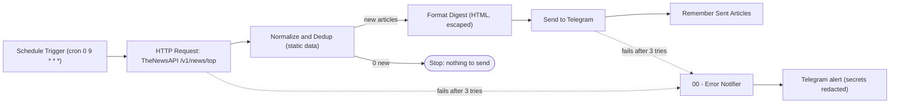

# News Telegram Automation

n8n workflows that fetch top headlines from [TheNewsAPI](https://www.thenewsapi.com/) and deliver a
daily digest to a Telegram chat, with retries, de-duplication and failure alerts.

Built in 2025 as a set of n8n learning workflows; hardened in 2026 with credential hygiene, reliability
features, a workflow validator, tests, a pinned Docker setup and CI.

## What it does

| Workflow | Trigger | Purpose |
| --- | --- | --- |
| `00-error-notifier.json` | Error Trigger | Sends a redacted alert to Telegram when another workflow fails |
| `01-basic-trigger.json` | Manual | Minimal "hello world" Code node |
| `02-news-api.json` | Manual | Fetch headlines and build a message (no sending) |
| `03-telegram-integration.json` | Manual | Fetch headlines and send them to Telegram once |
| `04-scheduled-automation.json` | Daily cron, 09:00 | Main flow: fetch, de-duplicate, format, send, remember what was sent |



## Setup in 5 steps

Prerequisites: Docker with the Compose plugin, a Telegram account and a TheNewsAPI API token.

1. **Configure the environment**
   ```bash
   cp .env.example .env
   # set N8N_ENCRYPTION_KEY (openssl rand -hex 32); leave the rest for now
   ```
2. **Create the bot and find your chat ID**: create a bot with @BotFather, then run
   `./scripts/setup-telegram-bot.sh`. It checks the token, sends a test message and writes
   `TELEGRAM_CHAT_ID` to `.env`. The token itself is not saved. (`./scripts/get-chat-id.sh` only prints chat IDs.)
3. **Start n8n**
   ```bash
   docker compose up -d        # http://localhost:5678, create the owner account on first visit
   ```
4. **Add credentials** in n8n under *Credentials, Add credential*:
   - *Telegram API*, named `Telegram bot`: paste the bot token.
   - *Query Auth*, named `TheNewsAPI token`: name `api_token`, value: your API token.
5. **Import and activate**
   ```bash
   docker compose exec n8n n8n import:workflow --separate --input=/workflows
   ```
   Open each imported workflow and select the two credentials on the HTTP and Telegram nodes. In
   `04 - Scheduled News Automation`, open *Settings* and set *Error workflow* to `00 - Error Notifier (Telegram)`.
   Run `03` once to test, then activate `04`.

## Configuration

| Variable | Required | Default | Used by |
| --- | --- | --- | --- |
| `N8N_ENCRYPTION_KEY` | yes | none | n8n: encrypts stored credentials; keep it stable |
| `GENERIC_TIMEZONE` | no | `UTC` | n8n: timezone for the 09:00 schedule |
| `N8N_BLOCK_ENV_ACCESS_IN_NODE` | yes | `false` | n8n 2.x blocks `$env` by default; the workflows read the values below via `$env` |
| `TELEGRAM_CHAT_ID` | yes | none | 03, 04, 00: digest recipient |
| `TELEGRAM_ALERT_CHAT_ID` | no | `TELEGRAM_CHAT_ID` | 00: failure alert recipient |
| `NEWS_LOCALE` | no | `us` | TheNewsAPI `locale` filter |
| `NEWS_LANGUAGE` | no | `en` | TheNewsAPI `language` filter |
| `NEWS_LIMIT` | no | `3` | Articles per request (your API plan may cap this) |

Secrets (bot token, API token) live only in n8n's encrypted credential store, never in `.env` or the
workflow JSON. To change the schedule, edit the cron expression on the *Schedule Trigger* node.

## Reliability features

- **Retries with backoff**: the News API and Telegram nodes retry up to 3 times (3 s and 5 s apart).
- **Timeouts**: 15 s per News API request; 120 s per workflow execution (60 s for the notifier).
- **De-duplication**: article IDs (`uuid`, falling back to the URL) are kept in workflow static data,
  capped at the last 500. An ID is recorded only after Telegram accepts the message, so a failed send is
  retried on the next run instead of being lost.
- **Failure alerts**: `00-error-notifier.json` posts the workflow name, failing node and error message to
  Telegram. Token-like strings are redacted first.
- **Safe formatting**: messages use Telegram HTML mode with escaping, so headlines containing `*`, `_`
  or `<` no longer break delivery; output is capped below Telegram's 4096-character limit.
- **Validation**: `tools/validate_workflows.py` fails CI on invalid JSON, duplicate node names or ids,
  broken connections, inline secrets, hard-coded chat IDs, pinned data or undocumented `$env` variables.

## Development

```bash
python3 -m venv .venv && . .venv/bin/activate
pip install -r requirements-dev.txt
python tools/validate_workflows.py workflows --env-example .env.example
pytest
shellcheck scripts/*.sh
```

CI (`.github/workflows/ci.yml`) runs the same checks, plus a JSON lint and `docker compose config`.

## Limitations

- n8n saves static data only for production executions (an active workflow started by its trigger).
  Manual test runs never mark articles as sent, so running `04` by hand can send the same headlines again.
- The duplicate history lives in n8n's database: it survives restarts but is lost if the `n8n_data`
  volume is deleted or the workflow is re-imported as a new workflow.
- If Telegram accepts a message but the response never arrives, the retry can send a duplicate digest.
  For a news digest that is a better trade-off than missing a message.
- The error workflow has to be linked by hand after import, because workflow IDs differ per instance.
- One news provider only: when TheNewsAPI is down or the quota is used up, no digest is sent
  (the failure alert still fires).
- The workflow JSON is written for n8n 2.x and checked statically in CI; CI does not import it into a
  running n8n instance.
